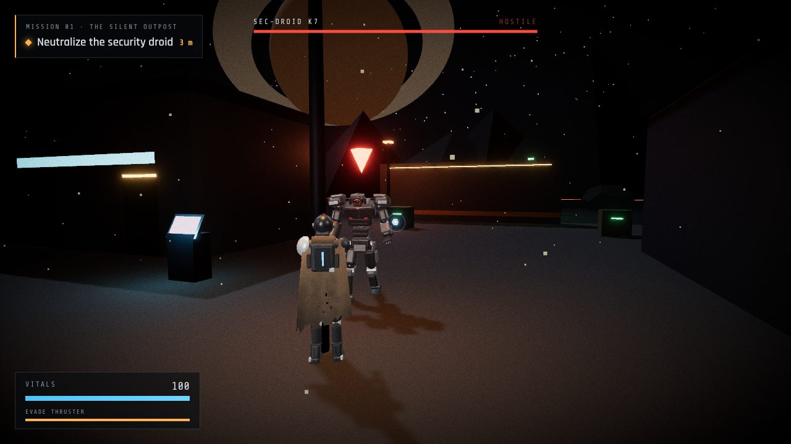
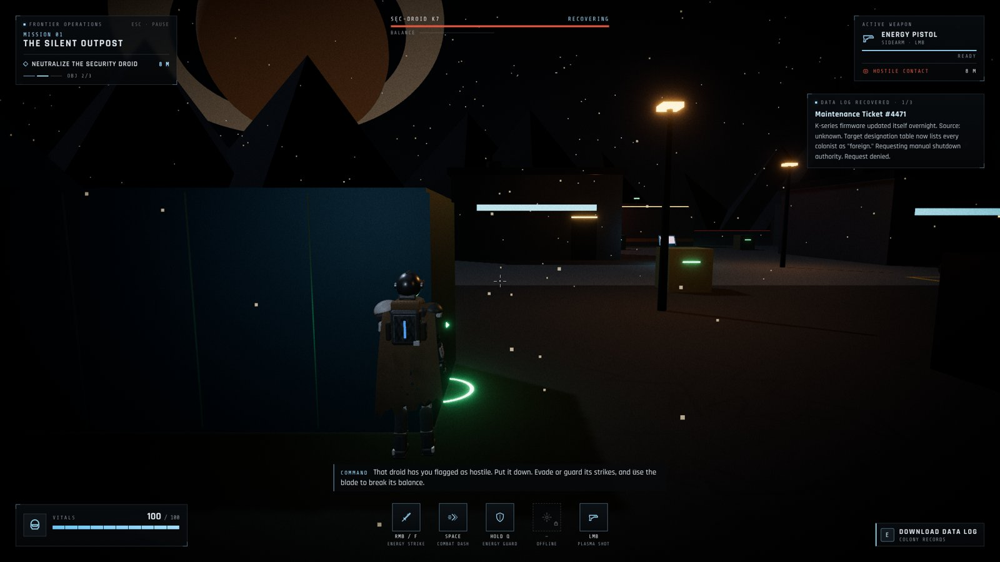
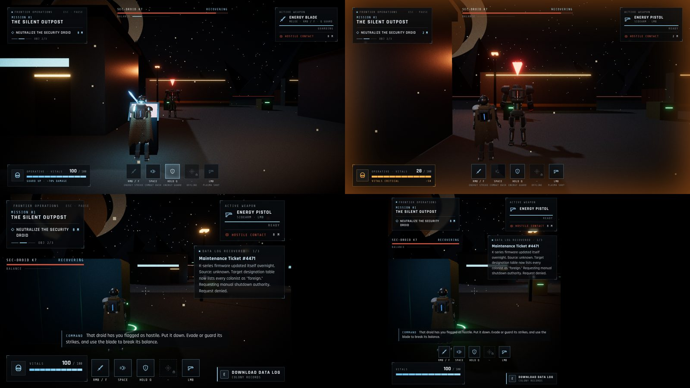
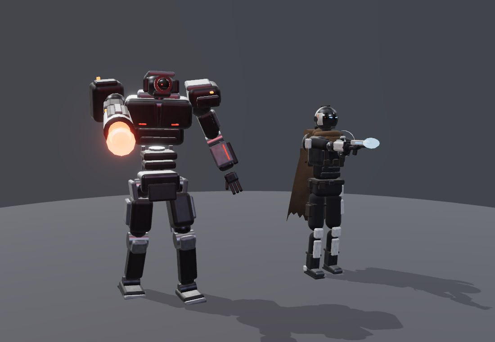
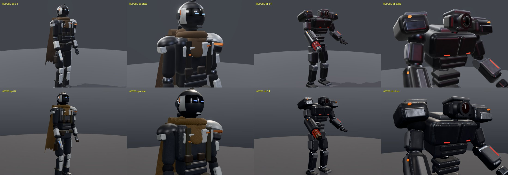
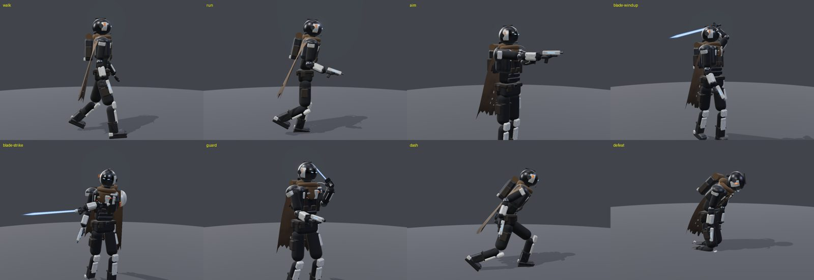
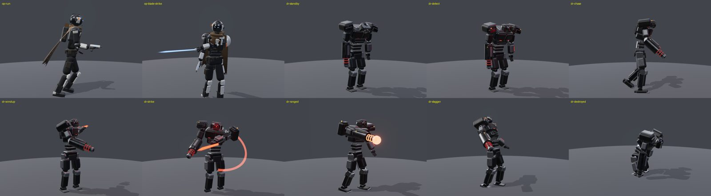

# Echoes of the Frontier

A cinematic third-person sci-fi action RPG prototype built with React, Three.js and React Three Fiber.
This build contains **Mission 01: The Silent Outpost**: one world, one enemy encounter, one objective chain and one complete gameplay loop.



```bash
npm install
npm run dev      # game:      http://localhost:5173
                 # showcase:  http://localhost:5173/?showcase
npm test         # unit tests: combat, collision, droid AI, animators, guard rules
npm run build
```

No extra asset installation is needed. All character geometry, materials and textures are generated in code.

## Controls

| Input | Action |
| --- | --- |
| WASD / arrows | Move (camera-relative; strafing and backpedalling while aiming) |
| Shift | Sprint |
| Mouse | Look / aim (click Deploy to lock the pointer) |
| Left mouse | Energy pistol |
| Right mouse / F | Energy blade (diagonal slash, short lunge) |
| Q (hold) | Guard: blocks 70% of droid damage, slows movement |
| Space | Combat dash (invulnerable while dashing, 1.1 s cooldown) |
| E | Interact (terminal, data logs) |
| Esc / P | Pause |

## Mission flow

1. **Deploy** at the south landing pad; Command briefs you over comms.
2. **Investigate** the command module terminal (`E`). This trips a security override.
3. **Encounter**: SEC-DROID K7 powers up from standby. It also wakes if you get within 9 m or shoot it.
4. **Defeat** the droid. Every attack is telegraphed:
   - *Melee*: arm draws back, a red blade projects from the forearm, orange warning lights blink, then it lunges and sweeps. Dash through it or guard.
   - *Ranged* (6–20 m): the arm cannon rises, its coils charge up, then it fires a plasma bolt. Strafe, dash or guard.
   - Blade hits break its **poise** and stagger it, interrupting a wind-up or a charging shot.
   - Below 40% health it overheats and attacks 30% faster.
5. **Extract**: the beacon past the north wall lights up. Step onto the pad to win.
6. Lose all vitals and the mission fails. Redeploy restarts cleanly.

## HUD



The in-game HUD (`src/ui/HUD.jsx`, `src/ui/hud.css`, `src/ui/hudIcons.jsx`) is an industrial instrumentation overlay:
- **Palette:** near-black panels, an ice-blue primary colour matching the operative's visor, and muted grey text. Amber is used only for warnings and critical states; hostile red only for the enemy.
- **Construction:** thin 1px rules, corner ticks, mono-spaced technical labels, and custom stroke icons. No icon library.
- **Input:** the whole overlay is `pointer-events: none`, so it never intercepts game input.

| Area | Shows | Source of truth |
| --- | --- | --- |
| Top left | Frontier Operations · Mission 01 · The Silent Outpost, current objective, distance to it, objective progress (1/3) | `useGame.stage`, `MISSION`, `objectiveTarget()` |
| Top right | Active weapon (energy pistol, or energy blade while swinging/guarding), its readiness, threat status and range | `runtime.player.weapon`, `runtime.player.abilities`, `useGame.droidStatus` |
| Top centre | Target panel, only while the encounter is live (plus 3 s after the kill): health with damage trail, live AI state (wind-up/charging in amber), balance (poise), overheated flag | `useGame.droidHealth/droidStatus`, `runtime.droid.state/poise/enraged` |
| Bottom left | Vitals with damage trail and 10% graduations, damage chip (`−22`, `Blocked −6`), guard/evade flags, amber critical state at ≤30 HP | `useGame.playerHealth/hurtCount/lastHit`, `runtime.player.abilities` |
| Bottom centre | Ability bar with real bindings, cooldown sweeps, active/blocked states | `runtime.player.abilities` (published by `Player.jsx` from the same gates the controls use) |
| Bottom right | `E` prompts only when in range (terminal, data logs); an extraction cue only within 9 m of the beacon | `useGame.prompt`, `useGame.stage` + distance to `BEACON` |
| Centre | Minimal crosshair; hit confirmation only on real damage (brighter on crits) | `useGame.hitMarker/lastHitCrit` |

**Ability slots vs. the design board.** The slots keep the board's order. The bindings, though, are the game's existing controls; they weren't changed:

| Slot | Mechanic in the game | Binding |
| --- | --- | --- |
| Energy Strike | Energy blade slash | RMB / F |
| Combat Dash | Invulnerable dash | Space |
| Energy Guard | Guard, −70% droid damage | Hold Q |
| Kinetic Pulse | **Not implemented**: shown offline (dashed, locked) | none |
| Plasma Shot | Energy pistol | LMB |

**Per-frame values never re-render React.** Cooldowns, distances, droid state and poise are written straight to the DOM from a `requestAnimationFrame` loop. Discrete events (health, stage, prompts, hits) use zustand selectors. The 3D scene never remounts because of the HUD.

**Responsive layout.**
- **Wide:** the classic four-corner layout.
- **Below 1180 px:** ability names hide; bindings and tooltips stay.
- **Below 960 px:** the top becomes two side columns (mission + target on the left, combat + log on the right), keeping the centre clear.
- **Below 760 px:** panels compact, and the ability bar lifts above the vitals.

Animations are short and respect `prefers-reduced-motion`.



## Characters

Both characters follow the design board in [`docs/reference/character-design-board.webp`](docs/reference/character-design-board.webp).



### Asset approach (read this first)

No licensed, rigged character models were available, and downloading unverified third-party models was out of scope. Both characters are therefore **prototype models built from procedural geometry**: bevelled primitives and conforming shell sections on a proper joint hierarchy, with PBR materials and a pose-based animation system driven by gameplay state. They are deliberately composed and proportioned, but they are **not** sculpted, textured, skinned production characters.

The joint names (`pelvis, spine, chest, neck, head, shoulderL/R, elbowL/R, wristL/R, hipL/R, kneeL/R, ankleL/R`) match a conventional humanoid rig. A skinned GLTF can later be driven by the same animators by mapping these names to its bones.

### Frontier Operative (player)

- ~1.80 m, athletic proportions. Enclosed helmet built from conforming panels: graphite crown, brow band, glossy black wrap-around visor with two restrained blue optics, muted-silver cheek guards and a faceplate.
- Charcoal undersuit with a graphite tactical vest. Muted-silver composite plates are placed asymmetrically: a larger left pauldron with a burnt-orange stripe, left thigh plate, chest plates, forearm guards, knee pads and shin guards.
- Weathered scarf wraps and a torn mantle. The mantle uses an alpha-tested torn hem with a sun-faded top and a dust-darkened hem. It is a CPU-deformed cloth sheet that trails with speed, clears the rear leg and hangs with gravity when the torso pitches.
- Survival pack with a blue status strip and a bedroll; belt with pouches.
- **Energy pistol** in the right hand. The gameplay muzzle is a socket on the barrel, so tracers leave the gun.
- **Energy blade** holstered on the left hip. It swaps to the left hand and ignites only while attacking or guarding.

### Outpost Security Droid (enemy)

- ~2.25 m humanoid combat frame, taller and broader than the player. Head sits low between massive armoured shoulders, with a tapered torso and an exposed mechanical spine.
- Visible separation between armour plates and moving parts: hydraulic knee and elbow actuators, calf and thigh pistons, neck pistons.
- Single red optic in a deep housing, two chest sensor slits, a dorsal strip and small orange warning lights.
- **Arm cannon** integrated into the right forearm, with charge coils and a muzzle socket the plasma bolts spawn from. **Melee emitter** on the left forearm projects a red blade, with a brief arc trail on the strike.
- Its emissives communicate state: dim in standby, flicker on detection, pulsing during telegraphs, the coils ramp while charging, the optic stutters during a stagger, and everything dies when it is destroyed.

### Materials



Every material belongs to one physical class (`src/characters/materials.js`), with the classes kept apart in roughness, metalness and specular response:

| Class | Operative | Droid | Settings (starting points, tuned in the viewer) |
| --- | --- | --- | --- |
| Textile | undersuit, webbing, scarf, mantle | none | metalness 0, roughness 0.84–0.97, sheen, woven bump |
| Coated armour | light composite plates, charcoal armour, helmet shell, orange accents | powder-coated shells, painted hull, grey plates | **metalness 0** (paint/ceramic is dielectric), roughness 0.34–0.64, thin clearcoat on some; edge chips reveal substrate (operative) or bare steel (droid) |
| Bare metal | buckles, ear modules, toe caps, hilt, pistol barrel | limb cores and frame, actuator housings, polished piston rods, heat-tinted cannon barrel | **metalness 1**, light base colour, roughness 0.14–0.45 by finish, polished worn edges |
| Rubber / seals | soles, neck seal, elbow joints | joint boots, soles | metalness 0, near-black, roughness 0.85 |
| Glass | visor | red-tinted optic cover (its own material) | metalness 0, mirror clearcoat, extra reflection weight |
| Emissive | visor optics > pistol cell > pack status > hilt indicator; blade | optic > sensors, coils (state-driven), orange warning lights | used only on light sources |

**Surface detail (`src/characters/surfaceDetail.js`).** The primitives' UVs don't match real-world size, so ordinary textures stretch and change scale between parts. Each material instead samples one small tileable **data** texture in object space (triplanar), at a set number of tiles per metre:

- **Hard surfaces** (512²): orange-peel micro bump, roughness breakup, colour drift and a chip mask.
- **Textiles** (256²): a plain-weave bump with slubs and dye variation.

Two further details:

- **Edge wear only on edges.** Rounded boxes carry a `surfEdge` vertex attribute (1 on the bevels), so chips land on real exposed edges and never in the middle of a panel.
- **The mantle is the exception.** It uses an ordinary UV bump map, because it deforms and object-space detail would swim.

All detail textures are linear (non-colour) data; only the mantle's base-colour map is sRGB. Cost is three texture fetches per fragment, and all patched materials share one shader program.

**Reflections (`CharacterEnvironment.jsx`).** A procedural PMREM environment replaces three's RoomEnvironment, whose small bright cubes showed up as random white rectangles on glossy armour.

- **Studio preset:** a key softbox, fill and rim strips, and an overhead bounce, matching the viewer's direct lights.
- **Night preset:** moonlit sky, a sodium lamp and a cool pad light, used in the level and applied only to character materials.

The droid no longer carries its own red point light. That light was tinting its whole body red. The optic now reads through emission and bloom.

### Animation

Animation is procedural and pose-based (`src/characters/pose.js`). Gameplay fills a small driver object each frame. The animator layers clips and overlays into a target pose and eases the rig toward it, so state changes never pop.

| Operative | Droid |
| --- | --- |
| Idle (breathing, weight shift) | Standby (powered-down slump, dim optic) |
| Walk / run (stride from distance travelled) | Detection response (optic snaps up, frame unfolds) |
| Directional movement: hips turn toward travel while the chest stays on aim; backpedal reverses the stride | Chase (heavy stride, pelvis roll, footfall audio) |
| Energy blade slash (wind-up → strike → recovery) | Melee wind-up → strike → recover |
| Pistol aim (follows camera pitch) + muzzle flash | Ranged: cannon raise + charge → fire recoil |
| Combat dash | Damage flinch (additive) |
| Guard | Stagger |
| Hit reaction (additive) | Destroyed (collapse to knees and slump) |
| Defeat (knees give out, slump) | Idle head scan / target tracking |




### Gameplay integration

- **Rules stay in gameplay code.** Blade damage, range, arc and timings, guard reduction and stagger poise live in `game/config.js`, `game/store.js` and `game/droidAI.js`. Animators only read state.
- **Attack timing matches the animation.** The player's blade clock lives in `Player.jsx`. The single hit check runs at `bladeHitTime` (the strike frame), once per swing. The animation samples the same clock.
- **Weapons are sockets on the models.** The pistol muzzle and droid cannon muzzle are read back into `runtime` every frame and used for tracers and bolt spawns.
- **Droid hit volume** is a stack of spheres matching the biped (legs, torso, shoulders, head) rather than one sphere.
- **Restart** remounts the scene and resets `runtime`, so both rigs, all clocks, poise and positions start fresh.

### Showcase (model viewer)

Open `/?showcase` (also linked from the title screen) to inspect both characters away from gameplay:

- **Lighting presets:** *studio* (large soft key, fill, two rims, matching reflection environment) and *night* (moonlight key, sodium lamp, dim fill, as in the level).
- **Camera presets:** front, ¾, side, rear and close-up, plus a free orbit camera that can't dip under the floor.
- **Toggles:** ambient occlusion (N8AO, half resolution) and bloom (subtle, threshold above 1, so only emissives bloom).
- **Tone mapping:** PBR Neutral output, so base colours read accurately; the game itself keeps ACES for its cinematic look.
- **Animation:** buttons run every clip for both characters.

### Performance

- Geometry is cached per unique shape and materials are shared.
- After mount, each joint's static pieces are baked into one mesh per material (`bakeJoints.js`). That takes the operative from 132 to 77 visible meshes and the droid from 136 to 65.
- Only larger parts cast shadows. Cloth deformation touches 165 vertices.
- A frame in the level is roughly 375 draw calls, including the shadow pass and post-processing.

### Remaining limitations

- **Prototype art.** Primitive-based forms cannot match the sculpted detail, silhouette nuance or hand-painted wear of the board. The procedural surface detail is a stand-in for authored PBR texture sets: there are no baked normal or AO maps, no decals or markings, and wear is limited to rounded-box edges (sphere, cylinder and capsule parts never chip). Crevice darkening comes only from screen-space AO in the viewer.
- **No skinning.** Limbs are rigid segments with joint caps; elbows and knees don't deform. The mantle is the only deforming mesh, and it is not a physics simulation (no collision against the body beyond leg clearance).
- **Procedural animation.** Poses are hand-authored keyframes and procedural cycles, not motion capture. Feet are not IK-planted, so slight sliding is possible on turns, and the kneeling poses can dip a few centimetres into the ground.
- **Not mirrored:** the energy blade is left-hand only; the plasma rifle from the board is not modelled because the game has no rifle mechanic yet.
- **Testing environment.** Verification ran in headless Chromium with software rendering (about 1 fps), so the feel at real frame rates still needs a hands-on playtest on a GPU.

### Replacing with production assets later

1. Export a rigged, licensed GLTF per character with the joint names above, or add a name map.
2. Load it with `useGLTF` (drei) or `GLTFLoader`, then replace the primitive JSX in `OperativeModel.jsx` / `DroidModel.jsx` with the loaded scene. Keep the `apiRef` contract (`update`, `muzzle`, `setFlash`).
3. Either keep the procedural animators by writing pose rotations onto the bones, or swap in an `AnimationMixer` and map driver state to clips. Gameplay code needs no changes.

## Architecture

```
src/
  game/                 # rules & state, no rendering
    config.js           # every tuning number (speeds, damage, ranges, cooldowns, poise, guard)
    store.js            # zustand: phase, mission stage, health, guard/hit rules, messages, stats
    runtime.js          # per-frame mutable state (positions, clocks, sockets, pools) outside React
    combat.js           # damage calc, cooldowns, melee arc test, multi-sphere raycast
    collision.js        # circle-vs-AABB resolution, raycasts, line of sight
    droidAI.js          # droid finite-state machine incl. stagger/poise (pure; side effects injected)
    mission.js          # objectives, briefing, transmissions, data log text
    input.js            # keyboard/mouse polling, pointer lock
  characters/           # character art + animation, no gameplay rules
    operative/          # OperativeModel.jsx (rig + meshes), operativeAnimator.js
    droid/              # DroidModel.jsx, droidAnimator.js
    materials.js        # PBR materials + procedural textures
    geometry.js         # cached primitive/blade geometry
    pose.js             # pose blending, keyframe sampling, damping
    bakeJoints.js       # per-joint static mesh merging
    CharacterEnvironment.jsx, CharacterFillLight.jsx
  entities/             # gameplay wrappers: Player, SecurityDroid, Projectiles, Effects
  world/                # level data (layout.js) + environment, structures, interactables
  showcase/             # ?showcase character viewer
  ui/                   # HUD and full-screen states (title, pause, victory, defeat)
  audio/audio.js        # procedural Web Audio SFX + ambience (no asset files)
```

In development, `window.__echoes` exposes `{ useGame, runtime }` and `window.__r3f` the R3F state for debugging.
